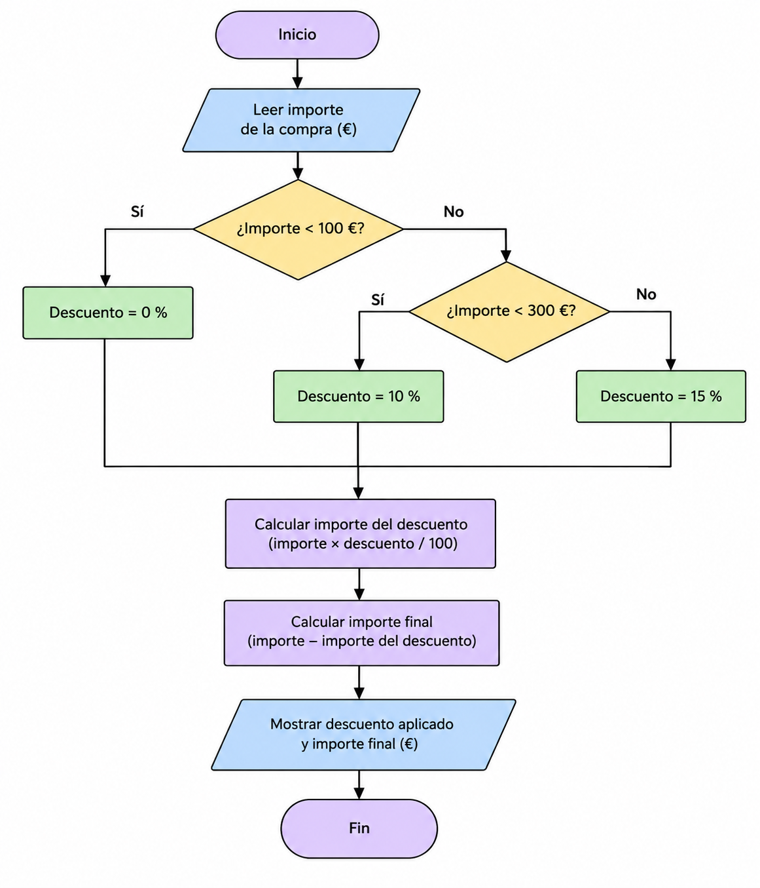

Práctica D3 - Del enunciado al programa
En esta pŕactica se requiere un programa en python que aplique un descuento según el importe de la compra. Si es menor de 100€ no hay descuento, si es desde 100€ se aplica 10% de descuento. Y si es desde 300€ se aplica un 30%. Además el programa no permitira que el importe sea negativo para evitar problemas.

Entradas; Salidas; Restriciones
Las entradas son los datos que requiere el programa.
Las salidas el el importe con el descuento aplicado
Las Restriciones son:
    Menos de 100€ --> 0%
	Desde 100€ --> 10%
	Desde 300€ --> 15%
	El importe no puede ser negativo

PSEUDOCÓDIGO
INICIO
    Leer importe
    Si importe < 100 ENTONCES
        descuento <- 0
    SINO SI importe < 300 ENTONCES
        descuento <- 10
    SINO
        descuento <- 15
    FIN SI
    importe_descuento <- importe * descuento / 100
    importe_final <- - importe_descuento
    Mosstrar descuento
    Mostrar importe_final
FIN

CODIFICACIÓN
    El programa fue realizado en python con el nombre de "descuento.py"
ORDINOGRAMA

